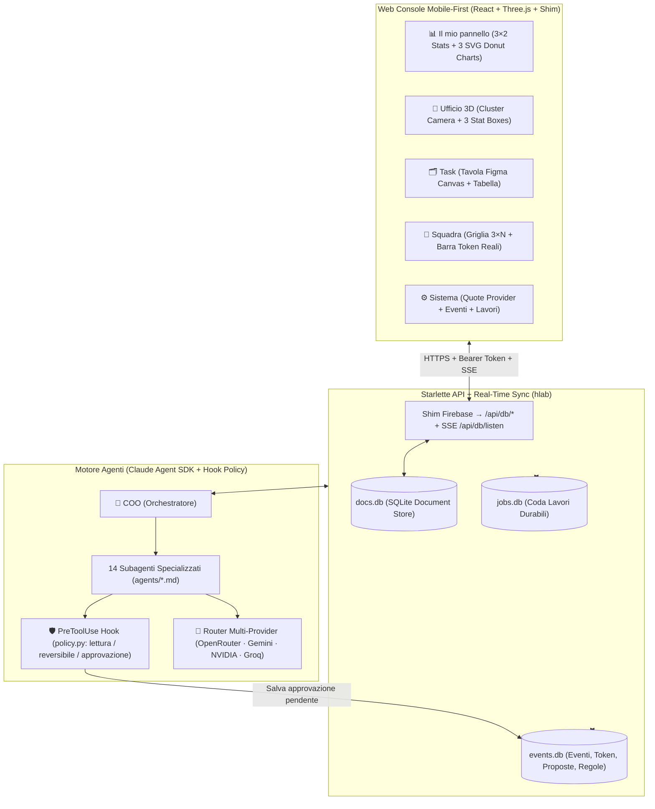

# Agency AI 3D — Squadra di Agenti IA con Ufficio 3D, Claude Agent SDK & Controllo Umano

> **"Gli agenti propongono, tu decidi."**  
> Sistema multi-agente autonomo basato su **Claude Code + Claude Agent SDK**, **Router Multi-Provider (OpenRouter / Gemini / NVIDIA / Groq / Cloudflare)**, **Database Documentale SQLite Real-Time (SSE)** e **Web Console Mobile-First con Ufficio 3D Isometrico** (derivato da *Agentes IA 3D* MIT con shim Firebase → Starlette/SQLite).

---

## 🎬 Video Demo — Il Sistema in Azione

<!-- Sostituisci o carica il file video in docs/demo-agency-ai.mp4 (oppure trascina l'MP4 direttamente in una Issue/PR di GitHub per ottenere l'URL user-attachments) -->
<div align="center">
  <video src="docs/demo-agency-ai.mp4" controls playsinline muted width="100%" poster="docs/poster-agency-ai.webp">
    Il tuo browser non supporta il tag video HTML5. <a href="docs/demo-agency-ai.mp4">Guarda il video demo (MP4)</a>.
  </video>
  <p><em>Dall'ordine su Telegram o Console → movimento degli agenti nell'Ufficio 3D → controllo permessi SQLite → approvazione 1-click e rilascio.</em></p>
</div>

---

## ✨ Funzionalità Principali (Web Console & Motore Backend)

### 1. 🏢 Ufficio 3D Isometrico con Telecamera Dinamica sul Cluster (`OfficeView.jsx` + `scene.js`)
- **Piano Unico con Sala Riunioni Centrale**: Quando gli agenti non stanno eseguendo un task individuale alla propria scrivania, convergono automaticamente al tavolo conferenze centrale in stato `In allineamento`.
- **Telecamera Inteligente ad Alta Densità (`getAgentsCentroid`)**: Calcola in tempo reale il baricentro del cluster a massima densità locale (raggio `6.5` unità) degli agenti IA e posiziona la telecamera ravvicinata (`zoom: 1.85` su mobile, `1.75` su desktop) esattamente dove lavora il gruppo più numeroso.
- **Full-Viewport Mobile Layout**: La scena 3D riempie dinamicamente il 100% dell'altezza utile dello schermo (`flex: 1`), con i soli **3 riquadri essenziali** in basso (`Connessi`, `Agenti Attivi`, `Al Lavoro`).

### 2. 📊 Dashboard Mobile-First con Grafici a Torta SVG & Toggle Range (`Dashboard.jsx`)
- **Toggle Range su Singola Riga**: Selettore istantaneo `[ Oggi | Settimana | Mese | Sempre ]` senza menu a tendina.
- **6 Riquadri Statistiche (3 per Riga)**: Griglia `3×2` compatta su mobile e desktop (`Agenti Attivi`, `Fatti / Totali`, `Da fare`, `In corso`, `In attesa`, `Correzioni`).
- **3 Grafici a Torta / Ciambella SVG (`DonutChartCard`)**: Alimentati dai dati reali di `events.db` e `docs.db`, con totale al centro e legenda a 2 colonne senza scrollbar orizzontali:
  1. **Distribuzione Task**: Ripartizione tra `Completati`, `Da fare`, `In corso`, `In attesa` e `Correzioni`.
  2. **Produttività & Azioni Squadra**: Ripartizione reale delle esecuzioni e tool invocati da ciascun agente.
  3. **Consumo Token per Agente**: Ripartizione reale dei token consumati (`events.db`) sull'intera squadra.

### 3. 👥 Squadra Unificata 3-per-Riga & Telemetria Token Reale (`TeamView.jsx`)
- **Griglia 3 Card per Riga (`repeat(3, minmax(0, 1fr))`)**: Mostra collaboratori umani e i 15 agenti IA in un'unica vista compatta con filtri rapidi (`Tutti`, `Agenti IA`, `Collaboratori`).
- **Barra Progressiva Token Reali**: Sotto ogni card viene mostrata la barra di avanzamento dei token reali consumati dall'agente (`tokensUsed` e `%` sul totale squadra) e il numero di azioni eseguite (`actionsCount`), calcolati da `Events.agent_stats()` su `events.db`.
- **Modale Dettagli al Click (`MemberDetailModal`)**: Aprendo una card si consultano descrizione, missione operativa, strumenti MCP/nativi (`toolsList`), skills (`skillsList`), consumo token dettagliato, task attivo con `LiveTimer` e comandi di gestione (`Modifica`, `Metti in riserva / Attiva`, `Elimina`).

### 4. 🗂️ Task & Pipeline All-in-One: Tavola Infinita Figma + Tabella (`KanbanView.jsx`)
- **Vista `Tavola` (Figma/Miro Canvas)**: Griglia infinita a 5 colonne (`📥 Triage / Da fare`, `⏱ In corso`, `⏳ In attesa di approvazione`, `🔧 Correzioni`, `✅ Completati`) con pan touch/mouse, zoom continuo (`40% – 160%`), barra di salto rapido colonna su mobile e presa in carico 1-click.
- **Vista `Tabella`**: Tabella ordinabile con cambio stato diretto, filtro per membro, toggle periodo su singola riga ed esportazione CSV.
- **Approvazione Inversa tramite Drag & Drop**: Spostare una card da `In attesa di approvazione` a `Completati` equivale a premere **Conferma** su Telegram (sblocca ed esegue la proposta sul CRM o il deploy del sito); spostarla in `Correzioni` la **Annulla** e registra il feedback per il `Memory Keeper`.

### 5. ⚙️ Pagina Sistema, Sentinella & Router Multi-Provider (`SystemView.jsx` + `router.py`)
- **Router Locale Antropico → Multi-Provider (`router.py` + `models.yaml`)**: Instrada i subagenti leggeri e forti su pool di modelli gratuiti o a basso costo (`OpenRouter :free`, `Google Gemini AI Studio`, `NVIDIA NIM`, `Groq`, `GitHub Models`, `Cloudflare Workers AI`) con rotazione automatica, cooldown sui `429` e fallback.
- **Sentinella Autonoma (`sentinel.py`)**: Controlla periodicamente la salute di tutti i servizi systemd, dei siti pubblicati e dei pool di modelli, testando nuovi modelli gratuiti e promuovendo solo quelli che superano le verifiche.

---

## 🏗️ Architettura del Sistema



---

## 🤖 I 15 Agenti IA Specializzati (`agents/*.md`)

Ogni agente è un file Markdown con frontmatter YAML (`name`, `description`, `model`, `effort`, `tools`, `mcp`, `skills`, `autonomy`, `max_turns`) e prompt di sistema rigoroso:

| ID Agente | Nome in Console | Ruolo & Specializzazione | Gruppi Strumenti MCP / Nativi | Autonomia |
| :--- | :--- | :--- | :--- | :---: |
| `coo` | **COO** | Orchestratore della squadra: riceve gli ordini, pianifica, delega agli specialisti e sintetizza i risultati. | `Agent`, `Skill`, `memory` | `1` |
| `account-crm` | **Account CRM** | Conosce clienti, contatti, progetti, incassi e storico; propone aggiornamenti su lead e clienti. | `crm_read`, `projects_read`, `proposals`, `graph_read` | `1` |
| `commerciale` | **Commerciale** | Calcola preventivi dal listino ufficiale (una tantum + mensile) e prepara bozze d'offerta. | `crm_read`, `projects_read`, `pricing`, `drafts`, `proposals` | `1` |
| `project-manager` | **Project Manager** | Monitora scadenze, task aperti e progetti fermi (`stale_projects`); propone aggiornamenti URL/stato. | `projects_read`, `proposals` | `1` |
| `direttore-creativo` | **Direttore Creativo** | Trasforma i dati di un cliente nello `spec.json` completo del sito (posizionamento, struttura, palette, sezioni). | `crm_read`, `projects_read`, `site_design`, `WebSearch`, `WebFetch` | `1` |
| `art-director` | **Art Director** | Direzione artistica visiva, prompt fotografici/video, shader e coerenza estetica del brand (`art.md`). | `crm_read`, `projects_read`, `site_art`, `WebFetch` | `1` |
| `copywriter` | **Copywriter** | Scrive headline, argomentazioni di vendita, micro-copy, CTA e FAQ ad alta conversione (`copy.json`). | `crm_read`, `projects_read`, `site_copy`, `WebFetch` | `1` |
| `costruttore-siti` | **Costruttore Siti** | Compila il sito completo dallo spec, lo renderizza e lo verifica in Chromium headless (Playwright). | `site_build` | `1` |
| `deployer` | **Deployer** | Prepara Pull Request GitHub, anteprime Netlify e pubblicazioni su GitHub Pages dietro approvazione. | `powers` (`propose_github_pr`, `propose_site_publish`) | `1` |
| `ops-uptime` | **Ops Uptime** | Controlla raggiungibilità HTTP, certificati TLS, latenza dei siti clienti e stato dei servizi server. | `ops_read` | `0` |
| `performance` | **Performance** | Misura tempi di risposta, peso risorse, Core Web Vitals e colli di bottiglia dei siti web. | `projects_read`, `web_audit` | `0` |
| `seo` | **SEO** | Analizza title, meta tag, OpenGraph, heading, dati strutturati JSON-LD, sitemap e indicizzazione. | `projects_read`, `web_audit` | `0` |
| `sicurezza` | **Sicurezza** | Verifica passiva di header HTTP (CSP, HSTS, X-Frame-Options), esposizione file sensibili e configurazione TLS. | `projects_read`, `web_audit` | `0` |
| `memory-keeper` | **Memory Keeper** | Analizza i task approvati o rimandati in correzione e propone nuove regole permanenti per gli agenti. | `learning` | `1` |
| `sentinella` | **Sentinella** | Sorveglia provider LLM, quote, servizi systemd e pool del router; testa e ruota i modelli gratuiti. | `system_read`, `system_improve` | `2` |

---

## 📋 Cosa Puoi Fargli Fare (Comandi & Flussi Operativi)

| Area Operativa | Cosa Puoi Chiedere / Fare | Agenti Coinvolti | Strumenti / Azione Reale | Esempio di Comando (Chat, Task o Telegram) |
| :--- | :--- | :--- | :--- | :--- |
| **1. Fabbrica Siti Web End-to-End** | Creare o rifare un sito completo partendo da un link Google Maps o dal nome attività: ricerca dati, spec, direzione artistica, copy, build HTML/CSS/3D verificato in Playwright e proposta di pubblicazione. | `Direttore Creativo` → `Art Director` → `Copywriter` → `Costruttore Siti` → `Deployer` | `site_design`, `site_art`, `site_copy`, `site_build`, `site_publish` | *"Crea il sito per [Nome Attività / Link Maps]"* oppure *"Rifai il sito bistrot-centrale puntando sulle prenotazioni"* |
| **2. CRM: Clienti, Contatti & Conti** | Interrogare clienti, contatti, note, fatture e pagamenti; proporre modifiche a note, stati o scadenze con approvazione 1-click. | `Account CRM`, `COO` | `crm_read`, `proposals` (`propose_crm_update`) | *"Dammi la scheda completa di Ristorante Aurora e lo stato dei pagamenti"* |
| **3. Ricerca Lead & Prospecting** | Cercare nuove attività target per città/settore, analizzare presenza web/social e preparare l'angolo d'attacco commerciale. | `Commerciale`, `Seo`, `Account CRM` | `WebSearch`, `WebFetch`, `crm_read`, `pricing` | *"Analizza il sito [URL] e preparami 3 argomenti concreti per proporgli il rifacimento"* |
| **4. Preventivi & Bozze d'Offerta** | Calcolare preventivi una-tantum + canone mensile con il codice (zero errori di calcolo LLM) e salvare la bozza in coda d'approvazione. | `Commerciale` | `pricing`, `drafts` | *"Prepara un preventivo per Atelier Milano con sito vetrina 3D + manutenzione mensile"* |
| **5. Gestione Progetti & Scadenze** | Controllare scadenze a 7/14/30 giorni, individuare progetti fermi (`stale_projects`) e aggiornare URL di staging o produzione. | `Project Manager` | `projects_read`, `proposals` | *"Quali progetti sono fermi da più di 14 giorni e cosa scade questa settimana?"* |
| **6. Audit SEO, Performance & Sicurezza** | Eseguire controlli tecnici passivi su velocità, struttura SEO, meta tag e header di sicurezza (CSP, HSTS, TLS) dei siti. | `Seo`, `Performance`, `Sicurezza` | `web_audit`, `ops_read` | *"Fai un audit completo SEO, performance e sicurezza su tutti i nostri siti online"* |
| **7. Monitoraggio Infra & Pool LLM** | Controllare stato dei servizi, quote dei provider gratuiti e testare nuovi modelli LLM per aggiornare i pool del router. | `Sentinella`, `Ops Uptime` | `system_read`, `system_improve`, `ops_read` | *"Qual è lo stato del router e quali modelli gratuiti stanno rispondendo meglio oggi?"* |
| **8. Apprendimento dalle Correzioni** | Trasformare i tuoi feedback sulle schede rimandate in `Correzioni` in regole permanenti iniettate nel prompt dell'agente. | `Memory Keeper` | `learning` | Sposta una card in **Correzioni** con una nota oppure chiedi: *"Memory Keeper, proponi nuove regole dagli ultimi feedback"* |

---

## 🚀 Installazione Rapida (Ubuntu 24.04 / WSL2)

### 1. Dipendenze di Sistema e Ambiente Python

```bash
sudo apt update && sudo apt -y install python3-venv python3-pip git ufw sqlite3 nodejs npm
git clone https://github.com/Lorenzozero/agency-ai-3d-starter.git ~/hermes_lab
cd ~/hermes_lab

python3 -m venv .venv && source .venv/bin/activate
pip install -r requirements.txt
sudo npm install -g @anthropic-ai/claude-code
```

### 2. Configurazione `.env`

```bash
cp .env.example .env
chmod 600 .env
# Inserisci in .env le tue chiavi (es. OPENROUTER_API_KEY, GEMINI_FREE_API_KEY, NVIDIA_API_KEY, GROQ_API_KEY o ANTHROPIC_API_KEY)
```

### 3. Build del Frontend (Ufficio 3D + Console React)

```bash
cd app
npm install
npm run build
cd ..
```

### 4. Verifica del Sistema e Avvio

```bash
# Verifica registro agenti, skills, permessi e database
python -m hlab check

# Genera o leggi il token personale per accedere alla Web Console
python -m hlab api-token

# Avvia il router multi-provider (porta 8787) e l'API della Web Console (porta 8770)
python -m hlab router &
python -m hlab api --host 127.0.0.1 --port 8770
```

Per mantenerlo sempre attivo con `systemd`, copia i file da `deploy/*.service` e `deploy/*.timer` in `/etc/systemd/system/` e abilitali con `sudo systemctl enable --now hlab-router hlab-api hlab-worker`.

---

## 🧪 Test Suite

Il progetto include una suite completa di test (`pytest`) che verifica permessi, approvazioni monouso, router multi-provider, shim Firestore/SQLite, fabbrica siti, sentinella e sincronizzazione GUI:

```bash
pytest -q
```

---

## 📄 Licenze e Riconoscimenti

- **Backend, Orchestrazione Multi-Agente, Shim Firebase → SQLite, Router & Redesign Mobile-First**: MIT License — Lorenzo Garoffolo (`@Lorenzozero`).
- **Base Scena 3D (`app/src/office/*`)**: Derivata da [Agentes IA 3D](https://github.com/ederland/Agentes_IA_3D) (MIT License, vedi `app/LICENSE-ederland`).
