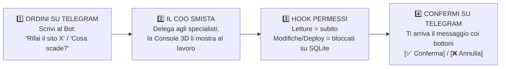

<div align="center">

# ⚡ Agency AI 3D

**15 Agenti IA Specializzati · Ordini & Approvazioni via Telegram · Ufficio 3D Live & Telemetria Web**

[](https://github.com/anthropics/claude-agent-sdk-python)
[](hlab/notify.py)
[](models.yaml)
[](app/src/office/scene.js)
[](app/LICENSE-ederland)

**Comandi la tua squadra di 15 agenti IA esclusivamente da Telegram (ordini e conferme 1-click), mentre osservi in tempo reale l'Ufficio 3D, i grafici a torta e i token consumati dalla Web Console di sola lettura.**

</div>

---

## 🎬 1. Come Appare in Azione

<div align="center">
  <video src="docs/demo-agency-ai.mp4" controls playsinline muted width="100%" poster="docs/poster-agency-ai.webp">
    
  </video>
</div>

---

## ❓ 2. Cosa Ti Serve e Quanto Costa? (Prima di Scaricarlo)

<table>
  <tr>
    <td width="33%" valign="top">
      <h4>🖥️ Dove Gira?</h4>
      <ul>
        <li><b>OS:</b> Ubuntu 22.04 / 24.04 o WSL2</li>
        <li><b>Minimo:</b> 2 vCPU · 4 GB RAM · 20 GB SSD</li>
        <li><b>Consigliato:</b> 4 vCPU · 8 GB RAM (qualsiasi VPS cloud, Oracle Free Tier o Mini-PC)</li>
      </ul>
    </td>
    <td width="33%" valign="top">
      <h4>💸 Quanto Costa in Token?</h4>
      <ul>
        <li><b>Domande & Monitoraggio (0 €):</b> Codice locale (<code>lean.py</code>) + Router su modelli gratuiti (<i>OpenRouter :free, Gemini, Groq, NVIDIA</i>)</li>
        <li><b>Lavoro con Strumenti MCP:</b> Abbonamento <b>Claude</b> (via <code>claude</code> CLI) oppure API Key con <b>tetto massimo</b> (es. <code>0.35 $/task</code>)</li>
      </ul>
    </td>
    <td width="33%" valign="top">
      <h4>🔒 Perché Comandi Solo da Telegram?</h4>
      <ul>
        <li><b>Separazione totale:</b> la Web Console è <b>100% read-only</b> (nessun bottone di modifica o esecuzione)</li>
        <li><b>Solo il tuo Chat ID Telegram</b> può inviare ordini o approvare azioni</li>
        <li><b>Zero Firebase / Cloud terzi:</b> tutti i dati restano nei tuoi SQLite locali</li>
      </ul>
    </td>
  </tr>
</table>

---

## 🔄 3. Come Funziona un Ordine? (100% Controllato da Telegram)



---

## 🤖 4. Chi Lavora per Te e Cosa Puoi Chiedergli su Telegram? (15 Agenti in 5 Reparti)

| Reparto | Agenti Inclusi | Cosa Puoi Scrivergli su Telegram (Esempi Reali) | Permessi |
| :--- | :--- | :--- | :---: |
| 🎯 **Direzione & Memoria** | `COO` · `Memory Keeper` | *"Pianifica i lavori della settimana"* · *"Memory Keeper, estrai nuove regole dagli ultimi feedback"*. | Propone (`1`) |
| 💼 **CRM & Commerciale** | `Account CRM` · `Commerciale` · `Project Manager` | *"Cosa scade nei prossimi 14 giorni?"* · *"Quali progetti sono fermi?"* · *"Prepara un preventivo per il cliente X"*. | Propone (`1`) |
| 🎨 **Fabbrica Siti Web** | `Direttore Creativo` · `Art Director` · `Copywriter` · `Costruttore Siti` · `Deployer` | *"Crea il sito per [Nome / Link Maps]"* → genera struttura, art direction, copy, HTML/3D testato in Playwright e anteprima. | Deploy dietro tuo OK su Telegram (`1`) |
| 🔍 **Audit & Qualità** | `SEO` · `Performance` · `Sicurezza` | *"Fai un audit SEO, velocità e sicurezza di tutti i nostri siti"* (verifica Core Web Vitals, meta tag, TLS, CSP/HSTS). | Sola lettura (`0`) |
| ⚙️ **Infra & Sentinella** | `Sentinella` · `Ops Uptime` | *"Tutti i siti e i servizi sono online?"* · Testa da sola i nuovi modelli gratuiti e aggiorna i pool di `models.yaml`. | Auto-tuning (`2`) |

---

## 📱 5. Cosa Osservi nella Web Console? (5 Viste di Telemetria Live)

<table>
  <tr>
    <td width="20%" valign="top" align="center">
      <b>📊 Pannello</b><br/><br/>
      Toggle periodo su 1 riga, <b>6 card (3×2)</b> e <b>3 Grafici a Torta SVG</b> (Task, Azioni, Token).
    </td>
    <td width="20%" valign="top" align="center">
      <b>🏢 Ufficio 3D</b><br/><br/>
      Sala riunioni centrale, <b>camera zoomata</b> sul gruppo di agenti al lavoro e 3 riquadri live.
    </td>
    <td width="20%" valign="top" align="center">
      <b>🗂️ Task</b><br/><br/>
      <b>Tavola Figma</b> infinita (pan/zoom) + <b>Tabella</b> di sola lettura con dettagli, output agente ed export CSV.
    </td>
    <td width="20%" valign="top" align="center">
      <b>👥 Squadra</b><br/><br/>
      Card compatte <b>3 per riga</b> con <b>barra token reali</b> (<code>events.db</code>) e scheda competenze al click.
    </td>
    <td width="20%" valign="top" align="center">
      <b>⚙️ Sistema</b><br/><br/>
      Salute servizi, quote provider LLM, lavori recenti e ultimi 40 eventi reali.
    </td>
  </tr>
</table>

---

## 🚀 6. Come Lo Installi e Accedi in 3 Minuti

```bash
# 1. Clona il repo e prepara Python + Claude Code
sudo apt update && sudo apt -y install python3-venv python3-pip git sqlite3 nodejs npm
git clone https://github.com/Lorenzozero/agency-ai-3d-starter.git ~/hermes_lab && cd ~/hermes_lab
python3 -m venv .venv && source .venv/bin/activate && pip install -r requirements.txt
sudo npm install -g @anthropic-ai/claude-code

# 2. Configura .env (TELEGRAM_BOT_TOKEN, TELEGRAM_CHAT_ID + chiavi OpenRouter / Gemini / Groq / NVIDIA)
cp .env.example .env && chmod 600 .env && nano .env

# 3. Compila la Console 3D e genera il Token di Login per la vista web
cd app && npm install && npm run build && cd ..
python -m hlab check
python -m hlab api-token     # <-- Copia questo token per aprire la Web Console

# 4. Avvia Router LLM (8787) + Console Web (8770)
python -m hlab router &
python -m hlab api --host 127.0.0.1 --port 8770
```

> 📱 **Come vedere la Console da smartphone senza aprire porte nel firewall:**  
> Lancia `cloudflared tunnel --url http://127.0.0.1:8770` (oppure `tailscale funnel 8770`), apri l'URL HTTPS generato e incolla il token restituito da `python -m hlab api-token`.

---

## 🛠️ 7. Come Personalizzi o Aggiungi un Agente Tuo?

Ogni agente è un file Markdown dentro [`agents/`](agents/_template.md):

```markdown
---
name: mio-agente
description: Spiega in 1 riga al COO quando delegare a questo agente.
model: sonnet
mcp: [crm_read, proposals]   # Solo i gruppi di strumenti che gli concedi
autonomy: 1                  # 0 = solo lettura | 1 = propone e aspetta il tuo OK su Telegram | 2 = reversibile
max_turns: 10
---
Scrivi qui in italiano il mansionario e le regole che l'agente deve seguire.
```

<details>
<summary><b>⚙️ Mantenimento H24 con Systemd, Struttura File e Test Suite (clicca per espandere)</b></summary>

### Avvio automatico H24 (`systemd`)
```bash
sudo cp deploy/hlab-*.service deploy/hlab-*.timer /etc/systemd/system/
sudo systemctl daemon-reload
sudo systemctl enable --now hlab-router hlab-api hlab-worker hlab-notify.timer hlab-sentinella.timer hlab-backup.timer
```

### Mappa delle Cartelle
```text
agency-ai-3d-starter/
├── agents/            # 15 agenti IA in Markdown (coo, account-crm, commerciale, deployer, sentinella...)
├── .claude/skills/    # 20 skills operative (audit, copy, costruzione siti, preventivi, salute sistema)
├── app/               # Web Console React + Three.js di sola lettura + Shim SQLite (src/shim/*)
├── hlab/              # Backend Python (api, api_sync, docstore, events, policy, router, sitefactory, tools)
├── deploy/            # Servizi systemd, timer e script SQL ruolo read-only per CRM Postgres
├── models.yaml        # Configurazione pool modelli gratuiti e fallback del router
└── tests/             # 28 moduli di test automatici (esegui con: pytest -q)
```
</details>

---

<div align="center">
  <sub>📖 <b>Guida architetturale completa passo-passo:</b> <a href="https://portfolio-lorenzo-garoffolo.vercel.app/blog/squadra-agenti-ia-claude-code-attivita">Come ti costruisci una squadra di agenti IA che gestisce la tua attività</a> · Base 3D derivata da <a href="app/LICENSE-ederland">Agentes IA 3D (MIT)</a></sub>
</div>
