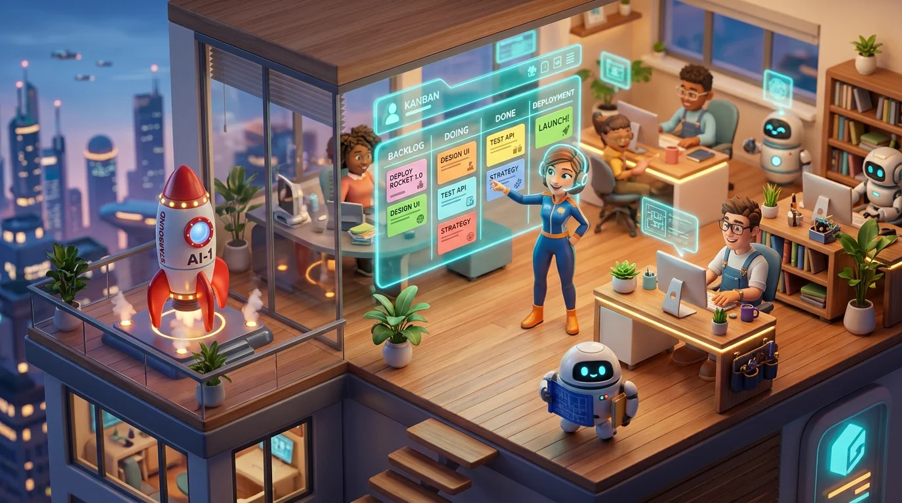
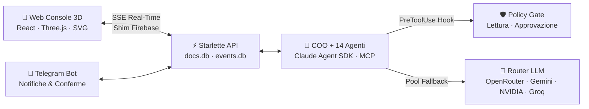

<div align="center">

# ⚡ Agency AI 3D

**Squadra di 15 Agenti IA Autonomi · Ufficio 3D Live · Claude Agent SDK · Controllo Umano 1-Click**

[](https://github.com/anthropics/claude-agent-sdk-python)
[](app/src/office/scene.js)
[](models.yaml)
[](hlab/docstore.py)
[](app/LICENSE-ederland)

> **Regola d'oro:** *Gli agenti propongono, tu decidi.* Nessuna scrittura sul CRM, preventivo o deploy parte senza il tuo **Sì**.

</div>

---

## 🎬 Demo Live

<div align="center">
  <video src="docs/demo-agency-ai.mp4" controls playsinline muted width="100%" poster="docs/poster-agency-ai.webp">
    
  </video>
</div>

---

## 🧩 Le 5 Viste della Console (Mobile-First)

<table>
  <tr>
    <td width="33%" valign="top">
      <h4>📊 1. Il Mio Pannello</h4>
      <ul>
        <li>Toggle range su 1 riga (<code>Oggi · Sett · Mese · Sempre</code>)</li>
        <li>Griglia <b>3×2</b> metriche live</li>
        <li><b>3 Grafici a Torta SVG</b> (Stato Task, Azioni Squadra, Consumo Token)</li>
      </ul>
    </td>
    <td width="33%" valign="top">
      <h4>🏢 2. Ufficio 3D</h4>
      <ul>
        <li>Piano unico con <b>Sala Riunioni</b> centrale</li>
        <li>Camera ravvicinata sul <b>cluster più denso</b> di agenti</li>
        <li>3 soli indicatori: <code>Connessi · Attivi · Al lavoro</code></li>
      </ul>
    </td>
    <td width="33%" valign="top">
      <h4>🗂️ 3. Task (Tavola + Tabella)</h4>
      <ul>
        <li><b>Tavola Figma</b> infinita (pan/zoom + Triage 1-click)</li>
        <li><b>Tabella</b> ordinabile + export CSV</li>
        <li>Trascina su <i>Completati</i> = <b>Approva ed esegui</b></li>
      </ul>
    </td>
  </tr>
  <tr>
    <td width="33%" valign="top">
      <h4>👥 4. Squadra & Token</h4>
      <ul>
        <li>Griglia compatta <b>3 card per riga</b></li>
        <li><b>Barra progressiva Token</b> reali da <code>events.db</code></li>
        <li>Click sulla card → Missione, Tool MCP, Skills e Timer</li>
      </ul>
    </td>
    <td width="33%" valign="top">
      <h4>⚙️ 5. Sistema & Router</h4>
      <ul>
        <li>Stato live servizi <code>systemd</code> e siti online</li>
        <li>Quote provider LLM e rotazione modelli <code>:free</code></li>
        <li>Registro ultimi 40 eventi e coda lavori durabili</li>
      </ul>
    </td>
    <td width="33%" valign="top">
      <h4>🛡️ 6. Sicurezza & Permessi</h4>
      <ul>
        <li>Hook <code>PreToolUse</code> su ogni chiamata MCP</li>
        <li>Approvazioni monouso salvate su SQLite (<code>events.db</code>)</li>
        <li>Tetto di spesa per singolo task e giornaliero</li>
      </ul>
    </td>
  </tr>
</table>

---

## 🏗️ Architettura in 1 Colpo d'Occhio



---

## 🤖 La Squadra: 15 Agenti in 5 Reparti (`agents/*.md`)

| Reparto | Agenti | Cosa Fanno in Autonomia | Strumenti MCP / Nativi |
| :--- | :--- | :--- | :--- |
| 🎯 **Direzione & Memoria** | `COO` · `Memory Keeper` | Riceve ordini, smista i task agli specialisti e trasforma le tue correzioni in regole permanenti. | `Agent`, `Skill`, `memory`, `learning` |
| 💼 **CRM & Commerciale** | `Account CRM` · `Commerciale` · `Project Manager` | Schede clienti, incassi, progetti fermi, scadenze e preventivi calcolati via codice dal listino. | `crm_read`, `projects_read`, `pricing`, `drafts`, `proposals` |
| 🎨 **Fabbrica Siti Web** | `Direttore Creativo` · `Art Director` · `Copywriter` · `Costruttore Siti` · `Deployer` | Da link Google Maps o nome → `spec.json`, art direction, copy, build verificato in Playwright e deploy. | `site_design`, `site_art`, `site_copy`, `site_build`, `powers` |
| 🔍 **Audit & Qualità** | `SEO` · `Performance` · `Sicurezza` | Audit passivi su Core Web Vitals, meta tag/JSON-LD, certificati TLS e header HTTP (CSP, HSTS). | `web_audit`, `projects_read` (`autonomy: 0`) |
| ⚙️ **Infra & Sentinella** | `Sentinella` · `Ops Uptime` | Uptime siti, salute servizi server, test automatico modelli gratuiti e aggiornamento pool `models.yaml`. | `system_read`, `system_improve`, `ops_read` |

---

## 🚀 Quickstart (4 Comandi)

```bash
# 1. Clona e installa il backend Python + Claude Code
git clone https://github.com/Lorenzozero/agency-ai-3d-starter.git ~/hermes_lab && cd ~/hermes_lab
python3 -m venv .venv && source .venv/bin/activate && pip install -r requirements.txt
cp .env.example .env && chmod 600 .env   # Inserisci le chiavi API in .env

# 2. Compila la Web Console 3D
cd app && npm install && npm run build && cd ..

# 3. Verifica i 15 agenti, le 20 skills e genera il token di login
python -m hlab check && python -m hlab api-token

# 4. Avvia Router Multi-Provider (8787) e Console API (8770)
python -m hlab router &
python -m hlab api --host 127.0.0.1 --port 8770
```

<details>
<summary><b>📂 Struttura della Repository (clicca per espandere)</b></summary>

```text
agency-ai-3d-starter/
├── agents/                 # 15 definizioni agenti (Markdown + YAML frontmatter)
├── .claude/skills/         # 20 skills operative (audit, copy, siti, CRM, preventivi)
├── app/                    # Frontend React + Three.js + Shim Firebase → SQLite
│   └── src/shim/           # 3 file che sostituiscono Firebase con Starlette/SSE
├── hlab/                   # Motore Python (API, sync, policy, router, sitefactory, tools MCP)
├── deploy/                 # Unit systemd (.service / .timer) e ruolo SQL read-only
├── models.yaml             # Pool di modelli LLM con rotazione e fallback
└── tests/                  # Suite completa pytest (28 moduli)
```
</details>

---

<div align="center">
  <sub>Guida completa sul blog: <a href="https://portfolio-lorenzo-garoffolo.vercel.app/blog/squadra-agenti-ia-claude-code-attivita">Come costruirsi una squadra di agenti IA con Claude Code e Ufficio 3D</a> · Licenza MIT (<a href="app/LICENSE-ederland">Agentes IA 3D</a>)</sub>
</div>
